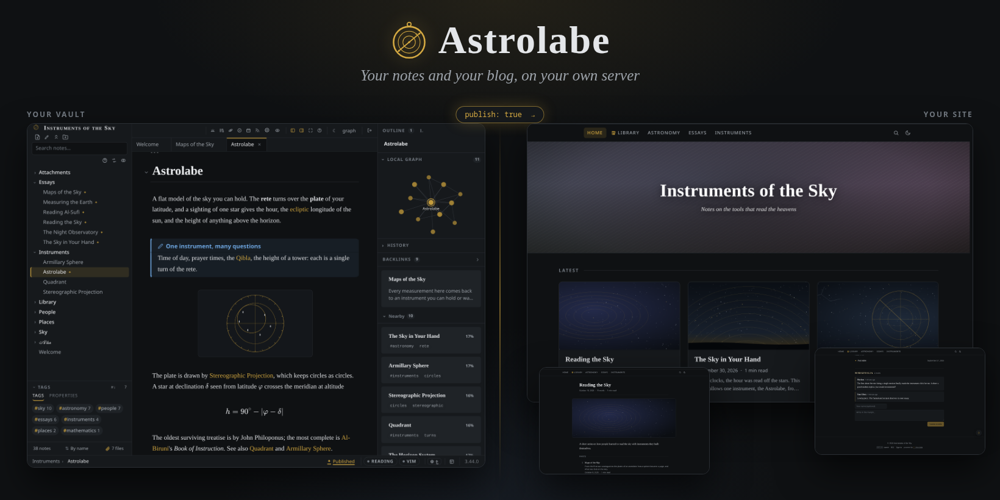
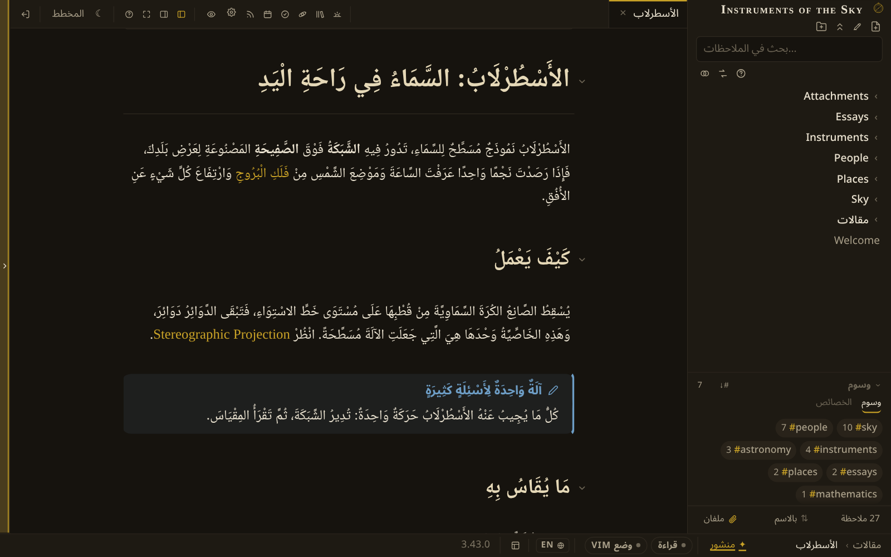
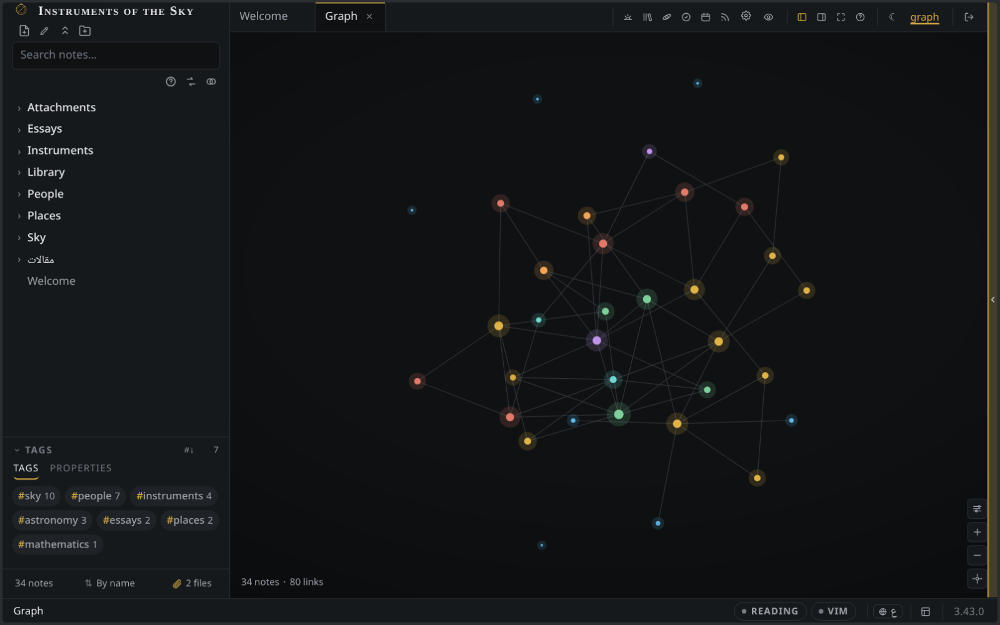
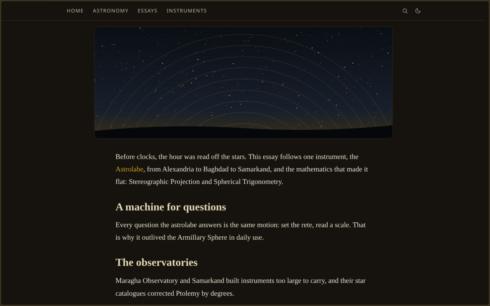
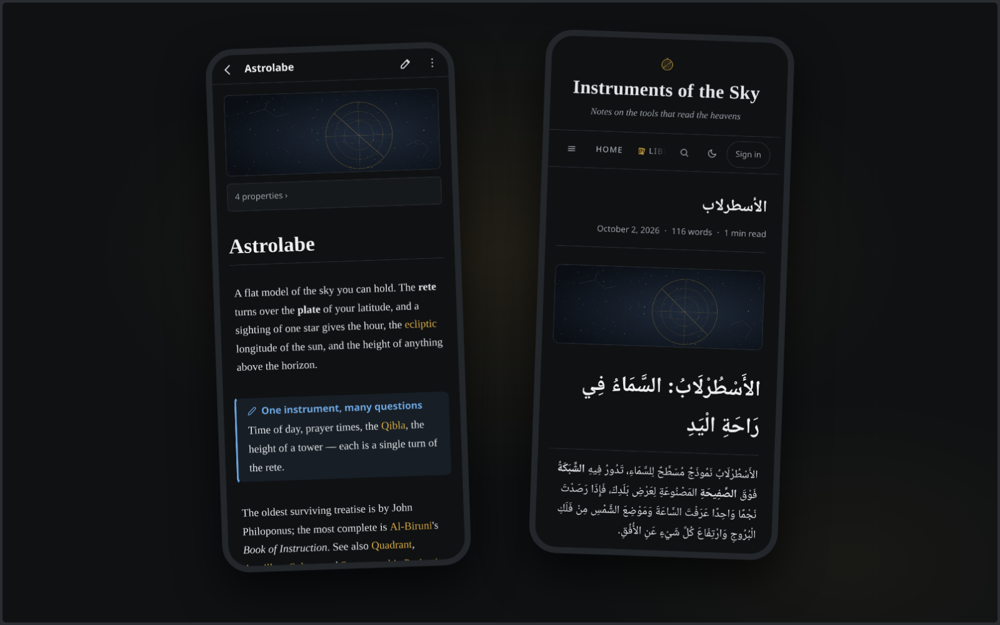

<p align="center"></p>

<p align="center">A self-hosted Markdown notes app and blog, in Arabic and English.</p>

```sh
git clone https://github.com/ZahakJ/astrolabe.git && cd astrolabe && npm install && npm start
```

Node ≥ 24, then open http://localhost:6801. Desktop builds and the Android app are on the
[latest release](https://github.com/ZahakJ/astrolabe/releases/latest).

- **Plain files.** A folder of Markdown and LaTeX, read and written in place; an Obsidian vault opens unchanged.
- **Writing.** Live preview, wikilinks, backlinks, embeds, callouts, KaTeX, tables, vim keys, word goals.
- **Arabic and English as equals.** A mirrored interface, per-line direction, vocalised text set cleanly, Hijri dates, search that folds diacritics.
- **Publishing.** `publish: true` (or a date) puts a note on your blog, with RSS, comments and designed pages.
- **Reading and study.** A PDF and EPUB reader that cites into notes, trackers, daily sigils, spaced repetition.
- **Your machine.** One Node process, git backup to a remote you own, no telemetry; desktop and Android apps.

<p align="center"><br></p>

**Manual:** [English](https://zahakj.github.io/astrolabe/site/en/) · [العربية](https://zahakj.github.io/astrolabe/site/ar/) · [source](docs/README.md)

**Compared with** [Obsidian, Logseq and Joplin](docs/comparison.md) · **Configuration:** [docs/configuration.md](docs/configuration.md) · **Development:** [docs/development.md](docs/development.md), [CONTRIBUTING.md](CONTRIBUTING.md)

[MIT](LICENSE)
