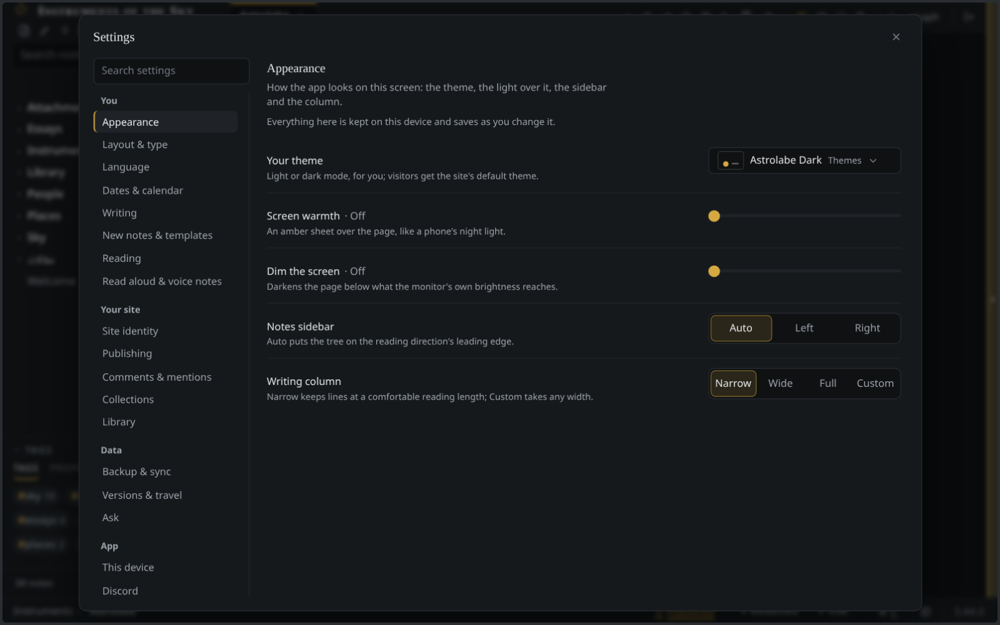

<p align="center"></p>

<p align="center">A self-hosted, open-source alternative to Obsidian, with publishing built in.</p>

Astrolabe is a Markdown notes app that runs on your own server. It opens a folder of plain files,
including an existing Obsidian vault, and you reach it from any browser, the desktop app or the
Android app. Notes you mark as public become a blog on the same server. Compared with Obsidian:

- **Publishing is built in:** `publish: true` puts a note on your blog, with RSS, reader comments and scheduled posts. No Publish subscription.
- **No sync service:** the server holds the vault, every device opens the same notes, and history is backed up to a git remote you own.
- **A web app:** your notes from any device with a browser, at home or behind your own domain, plus desktop (Linux, Windows) and Android apps.
- **Your vault as it is:** wikilinks, embeds, callouts, properties, highlights and footnotes are read as Obsidian writes them, and the folder keeps working in Obsidian.
- **Open source** under the MIT license.

```sh
git clone https://github.com/ZahakJ/astrolabe.git && cd astrolabe && npm install && npm start
```

<p align="center"><br></p>

## Features

**Writing**

- **Live-preview editor.** Markdown renders as you type and the source comes back under the caret; wikilinks with autocomplete, backlinks, embeds, callouts, tables you edit in place, footnotes and vim keys.
- **Graph and outline.** A graph of the vault coloured by folder or tag, a local graph per note, and an outline you can drag to reorder sections.
- **Search** with operators (`tag:`, `path:`, `before:`) that ignores accents and diacritics, so `cafe` finds `café`; search and replace across the vault with a preview and undo.
- **Math and LaTeX.** KaTeX in any note, and whole `.tex` files edited, linked and published like Markdown.
- **Focus.** Word goals from a note's properties, typewriter scrolling, and zen mode.
- **Right-to-left text.** Arabic, Persian and Hebrew render and edit natively beside English, line by line, with their diacritics; the interface is also available in Arabic.
- **Templates and daily notes,** with `{{date}}` fields, plus drawings in the Excalidraw format.

**Reading and study**

- **Book reader** for PDF and EPUB. Highlights and citations go straight into the note beside the book.
- **Read aloud** in English, French, Arabic and Japanese, with voices that run on your own machine.
- **Trackers, sigils and orbits.** Trackers follow the books and courses you are working through, sigils mark daily habits, and orbits is spaced repetition over cards kept in your notes, with Anki import.
- **Ask the vault.** Search your notes by meaning and get cited answers, from a local model through Ollama or from Anthropic if you choose it.

**Publishing**

- **Selective publishing.** `publish: true` puts a note on your site and a date in its place schedules it. Everything else stays private, and `<!-- comments -->` inside a published note never reach a reader.
- **Blog mode** with topics, series, RSS, reader comments and webmentions, or a homepage you compose from sections in the designer.
- **A library** of books and courses built from folders of notes, read in order.

**Everywhere**

- **Desktop app** for Linux (AppImage, deb, pacman) and Windows, and an **Android app** that can also work on a vault kept in a private GitHub repository.
- **Offline.** The web app installs as a PWA and keeps the notes you have opened readable without a connection.
- **Backup and history** in a git remote you own.
- **Import** from Obsidian, Notion and Evernote.
- **No telemetry.** No analytics, no CDN requests, no account.

## Running it

Astrolabe needs Node 24 or later. After `npm start`, open http://localhost:6801. The first run
creates `./vault` with starter notes that double as a short manual.

To use a folder of notes you already have:

```sh
ASTROLABE_VAULT=~/notes npm start
```

To publish, set an admin password with `npm run hash-password`, put the hash and a
`SESSION_SECRET` in `.env`, add `publish: true` to the notes you want public, and serve the app
behind an HTTPS reverse proxy. See [Publishing and access](docs/publishing.md).

The desktop and Android builds are on the [latest release](https://github.com/ZahakJ/astrolabe/releases/latest).

## Documentation

- The manual, in [English](https://zahakj.github.io/astrolabe/site/en/) and [Arabic](https://zahakj.github.io/astrolabe/site/ar/), with its source in [`docs/`](docs/README.md)
- [How it compares](docs/comparison.md) with Obsidian, Logseq and Joplin
- [Configuration](docs/configuration.md): every `.env` key and setting
- [Development](docs/development.md) and [CONTRIBUTING.md](CONTRIBUTING.md)

## License

[MIT](LICENSE)
