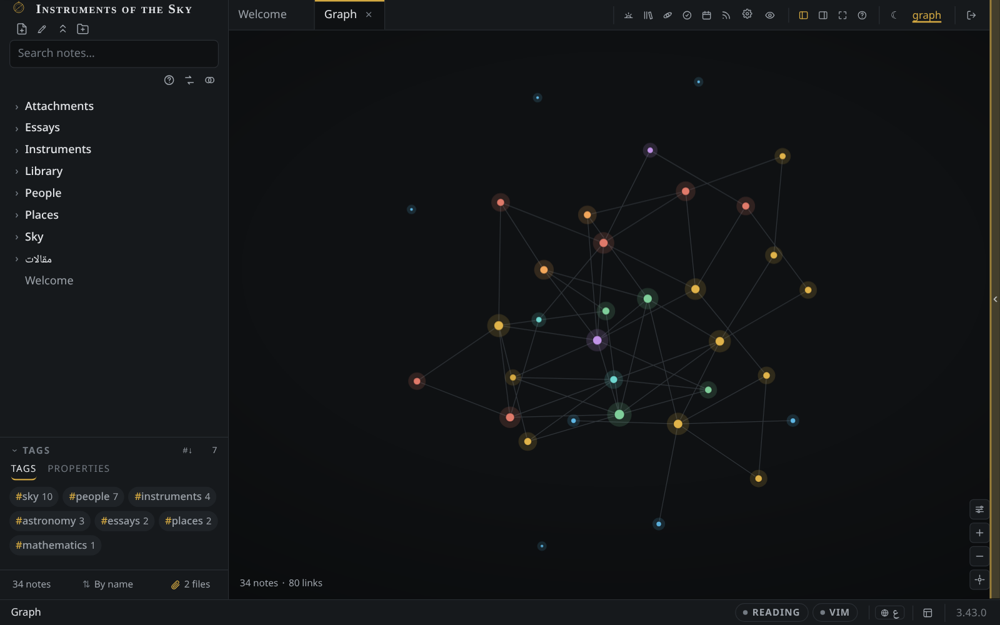
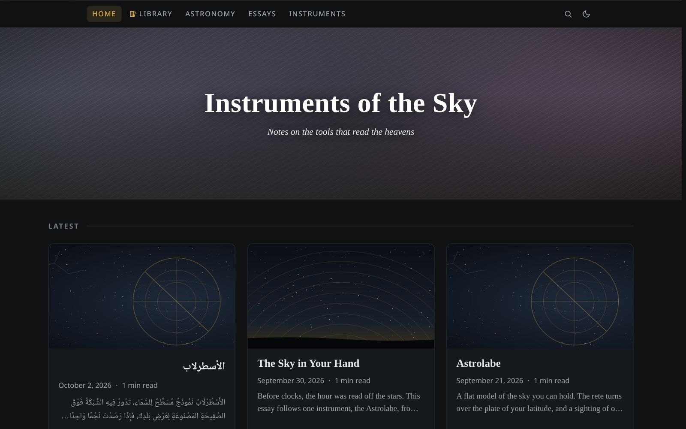

# Astrolabe

A self-hosted Markdown notes app and blog, in Arabic and English.

```sh
git clone https://github.com/ZahakJ/astrolabe.git && cd astrolabe && npm install && npm start
```

Needs Node ≥ 24. Open http://localhost:6801. The first run creates `./vault` with starter notes
that double as the manual.

Desktop builds (AppImage, deb, pacman, Windows) and the Android app are on the
[latest release](https://github.com/ZahakJ/astrolabe/releases/latest).



## What it is

One Node process over a folder of Markdown and LaTeX files. It edits, links, searches and
renders the notes, and can publish the ones you mark as a blog or a designed site. Everything it
knows comes from the files; there is no database for notes, and removing Astrolabe leaves the
folder as it was. The interface is fully translated into Arabic and mirrored right to left.

It opens in any browser on your network. The desktop app and the Android app are windows onto
the same server; the Android app can also work on a vault in a private GitHub repository with no
server.

## Features

- [Editor and reading view](docs/editor.md): live preview, wikilinks, backlinks, embeds, callouts, KaTeX, tables, vim mode
- [Search](docs/editor.md#navigating): operators (`tag:`, `path:`, `before:`), Arabic diacritics folded; search and replace across the vault with a dry run and undo
- [Templates and banners](docs/templates-and-notes.md), and [linguistic twins](docs/templates-and-notes.md#linguistic-twins) for one note in two languages
- [LaTeX notes](docs/latex.md): `.tex` files edited, linked and published like Markdown
- [Book reader](docs/books.md): PDF and EPUB, highlights cited into notes
- [Trackers](docs/trackers.md), [sigils](docs/sigils.md) (daily habits) and [orbits](docs/orbits.md) (spaced repetition, Anki import)
- [Today](docs/today.md), [calendar](docs/calendar.md) and [timeline](docs/timeline.md)
- [Drawings](docs/drawing.md) in Excalidraw format
- [Capture](docs/capture.md): quick capture, a web clipper bookmarklet, voice notes transcribed locally
- [Ask the vault](docs/ask.md): search by meaning and cited answers, from a local model through Ollama or from Anthropic if you choose it
- [Feeds](docs/feeds.md), [import](docs/import.md) from Notion, Evernote and Obsidian, [export](docs/export.md) and [printing](docs/printing.md)
- [Panes, tabs and windows](docs/workspace.md), [offline reading](docs/offline.md), [keymap](docs/keymap.md)
- [Publishing](docs/publishing.md): per-note `publish: true`, [blog mode](docs/blog-mode.md), [designed pages](docs/designer.md), a [library](docs/library.md) of courses, comments, RSS, [webmentions](docs/webmentions.md)
- [Themes](docs/theming.md) (46, checked against WCAG AA) and [typography](docs/typography.md) with self-hosted fonts
- [Arabic and RTL](docs/arabic-and-rtl.md), Hijri dates; [Japanese furigana](docs/japanese.md); [read aloud](docs/read-aloud.md) with offline voices
- [Backup and sync](docs/backup-and-sync.md) to a git remote you own, with note history
- [Desktop app](docs/desktop.md), [Android app](docs/mobile.md), [command-line client](docs/terminal.md), [Discord presence](docs/presence.md)
- No CDN requests, analytics or telemetry

How it compares with Obsidian, Logseq and Joplin: [docs/comparison.md](docs/comparison.md).

## Your own notes

Any folder of `.md` and `.tex` files is a vault, including one kept in Obsidian:

```sh
ASTROLABE_VAULT=~/notes npm start
```

Wikilinks, embeds, callouts, tags, frontmatter and `.excalidraw` drawings are read as other tools
write them. Nothing is converted or moved, and other tools' config folders are ignored.

## Publishing

Set an admin password (`npm run hash-password`, then `ADMIN_PASSWORD_HASH` and `SESSION_SECRET`
in `.env`), add `publish: true` to the notes you want public, and set `PUBLIC_LAYOUT=blog`. Put it
behind an HTTPS reverse proxy. Details: [Publishing and access](docs/publishing.md).



## Configuration

Every `.env` key and every setting: [docs/configuration.md](docs/configuration.md), and
[`.env.example`](.env.example).

## Documentation

The manual is at [zahakj.github.io/astrolabe/site/en](https://zahakj.github.io/astrolabe/site/en/)
and in Arabic at [/site/ar](https://zahakj.github.io/astrolabe/site/ar/). The source is
[`docs/`](docs/README.md).

## Development

`npm run dev` runs the server and Vite together. The checks a change must pass, the code layout
and how to send a change: [docs/development.md](docs/development.md) and
[CONTRIBUTING.md](CONTRIBUTING.md). [`DESIGN.md`](DESIGN.md) and [`CONTRACTS.md`](CONTRACTS.md)
hold the design rules and module contracts.

## License

[MIT](LICENSE)
