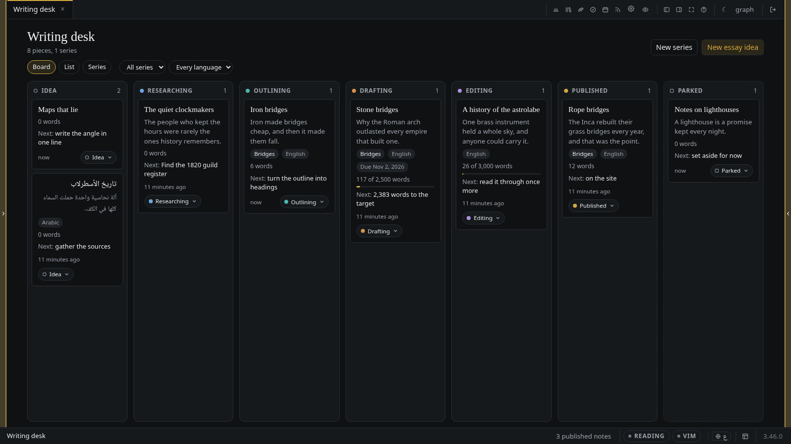
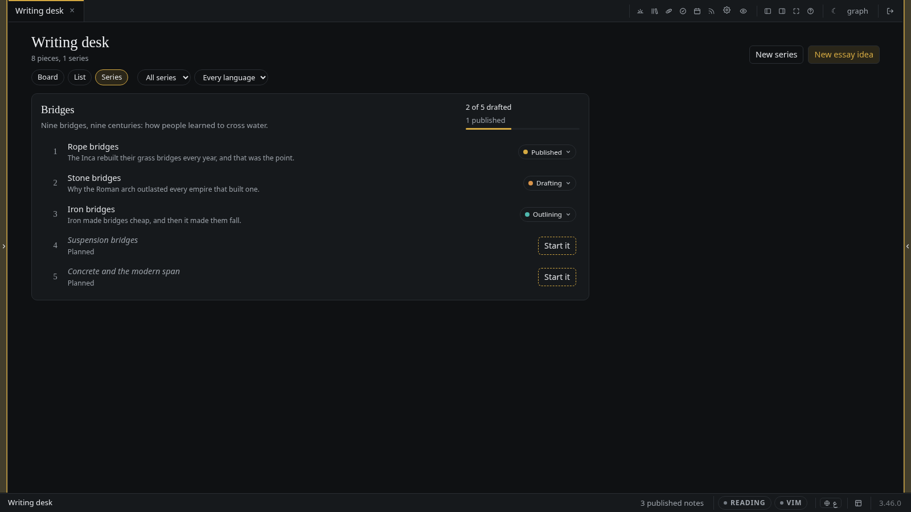
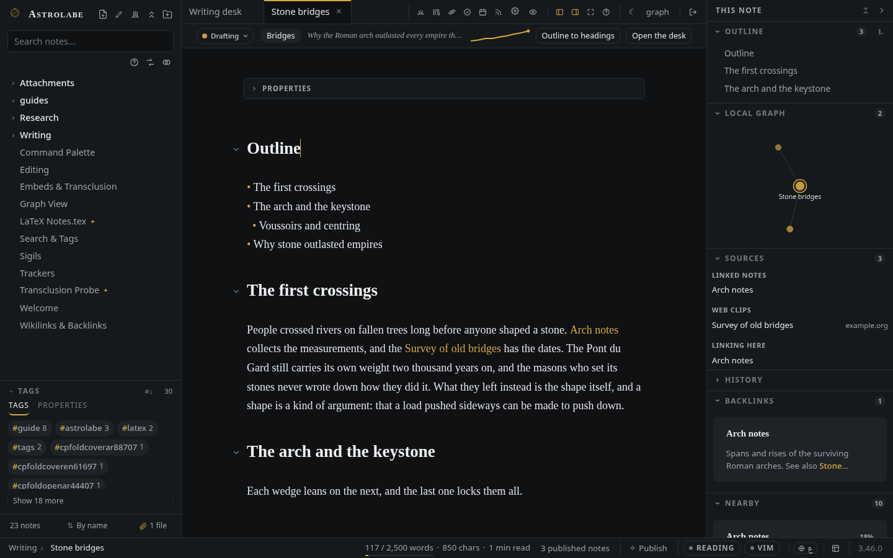

# مكتب الكتابة

*كل ما تنوي كتابته، من فكرة عابرة إلى مقالة منشورة: لوحة بحسب المرحلة، وقائمة، وسلاسلك مسارًا لكل منها مع ما أُنجز منها، وعلى كل مقالة مرحلتها وزاويتها ومصادرها وكيف نمت.*

← [العودة إلى README](../../README.md) · [كل الوثائق](../README.md)

---

أفكار المقالات تعيش عادةً في ثلاثة أماكن معًا: سطر في ملاحظة يومية، وعنوان في ملف اسمه *يومًا ما*،
وفي مؤخرة الرأس. المكتب يجمعها في مكان واحد من غير أن يطلب منك نقلها إلى أي مكان جديد. فالمقالة
تبقى ملاحظة عادية؛ والمكتب يقرأ ما تقوله مقدّمتها فقط ويرسمه.

**افتحه** من زر المكتب أعلى الشريط الجانبي، أو بكتابة **افتح مكتب الكتابة** في لوحة الأوامر، أو على
`/desk`. وعلى الهاتف هو سطر تحت **المزيد**. يُفتح تبويبًا، مثل التقويم والخط الزمني.



## المقالة ملاحظة

لنقل إنك تريد أن تكتب عن الجسور الحجرية. الملاحظة هي `Writing/Stone bridges.md`، وأعلاها:

```yaml
---
kind: essay
status: drafting
angle: "Why the Roman arch outlasted every empire that built one."
series: "[[Bridges]]"
lang: en
goal: 2500
due: 2026-11-02
---
```

| المفتاح | ما يقوله | أهو لازم؟ |
| --- | --- | --- |
| `kind: essay` | هذه الملاحظة مقالة. و`piece` و`post` بالمعنى نفسه | نعم |
| `status` | أين وصلت: `idea` (فكرة)، `researching` (بحث)، `outlining` (تخطيط)، `drafting` (مسودّة)، `editing` (تحرير)، `published` (منشورة)، أو `parked` لما أُجِّل. وملاحظة بلا مرحلة فكرة | لا |
| `angle` | سطر واحد: ما الذي تقوله المقالة. هو السطر الذي يجعل الفكرة أكثر من موضوع | لا |
| `series` | السلسلة التي تنتمي إليها، رابطًا إلى ملاحظة السلسلة | لا |
| `lang` | `en` أو `ar`. وإن تُرك قرأ المكتب اللغة من النص | لا |
| `priority` | `high` أو `medium` أو `low`؛ ترتّب البطاقات داخل العمود | لا |
| `due` | تاريخ بصيغة `YYYY-MM-DD`. والبطاقة التي فات موعدها تقول ذلك | لا |
| `goal` | هدف بعدد الكلمات، وهو `goal:` نفسه الذي يعدّ شريط الحالة مقابله (انظر [المحرر](editor.md)) | لا |
| `next` | الخطوة التالية بكلماتك. وإن تُركت اقترح المكتب خطوة بحسب المرحلة | لا |

لا يلزم إلا `kind:`. العنوان والزاوية مقالة كاملة في نظر المكتب، وكل ما سواهما يأتي لاحقًا.

## السلسلة

السلسلة ملاحظة أيضًا، فيها `kind: series` و`description:`، ومقالاتها مرتّبة تحت `series:`:

```yaml
---
kind: series
description: "Nine bridges, nine centuries: how people learned to cross water."
series:
  - "[[Rope bridges]]"
  - "[[Stone bridges]]"
  - "[[Iron bridges]]"
  - "[[Suspension bridges]]"
---
```

البند الذي يسمّي ملاحظة لم توجد بعد **موضع مخطَّط**: تعرف السلسلة أن المقالة آتية قبل أن يكون لها
ملف. يعرضه المكتب باهتًا ومعه **ابدأها**، فتُنشأ الملاحظة بجانب السلسلة وهي فيها من الأصل.

ويمكن للمقالة أن تنضمّ إلى سلسلة من جهتها أيضًا، بكتابة `series: "[[Bridges]]"` في مقدّمتها؛ فيسردها
المكتب بعد المقالات التي تسمّيها ملاحظة السلسلة. والترتيب الذي يهمّك مكانه ملاحظة السلسلة.

وهذا هو مفتاح `series:` نفسه الذي تستعمله المدونة [للسلسلة المنشورة](publishing.md)، فالسلسلة التي
اكتملت ونُشرت تصير بطاقة واحدة على الموقع بأجزائها مرتّبة، ولا يُكتب شيء مرتين. وعلى المقالة يعني
المفتاح *السلسلة التي أنتمي إليها*، والمدونة لا تمسّه.

## المكتب

يبدّل الشريط أعلاه بين ثلاثة عروض، ويرشّحها كلها بحسب السلسلة واللغة والمرحلة.

- **لوحة.** عمود لكل مرحلة، بالترتيب الذي تمضي فيه المقالة، ثم **مؤجَّلة**. على كل بطاقة العنوان
  والزاوية والسلسلة والكلمات مقابل الهدف (أو عددها وحده) والخطوة التالية ومتى عدّلتها آخر مرة.
- **قائمة.** المقالات نفسها صفوفًا مجموعة بحسب المرحلة، لتُقرأ نزولًا لا عرضًا.
- **سلاسل.** كل سلسلة مسارًا: وصفها، ومقالاتها بالترتيب والمواضع المخطَّطة بينها، وكم قطعت —
  *3 من 5 في المسودّة أو بعدها* تعدّ المقالات التي بلغت المسودّة أو تجاوزتها.



**نقل البطاقة** يغيّر `status:` ولا شيء غيره. وله ثلاث طرق:

- اسحب البطاقة إلى عمود آخر بالفأرة أو القلم؛
- ومن لوحة المفاتيح: ضع التركيز على بطاقة، واضغط `Space` لترفعها، وانقلها بين الأعمدة بالأسهم، ثم
  `Space` مرة أخرى لتضعها (و`Escape` يعيدها مكانها)؛
- أو اضغط زرّ المرحلة على البطاقة واختر عمودًا. وعلى الهاتف هذه هي الطريقة؛ فالإصبع على اللوحة
  يمرّرها.

## على كل مقالة

المقالة المفتوحة في المحرر يعلوها شريط رفيع: زرّ مرحلتها، وسلسلتها، وزاويتها، وخط صغير لعدد
كلماتها في كل يوم، وزرّان.



**المخطط إلى عناوين.** اكتب الخطة قائمةً تحت عنوان اسمه `Outline` (أو `المخطط`):

```markdown
## المخطط

- العبور الأول
- القوس وحجر الغلق
  - الصنج والقالب
- لماذا عاش الحجر بعد الإمبراطوريات
```

يكتب **المخطط إلى عناوين** كل بند عنوانًا بعد المخطط، والبند المتداخل أعمق بدرجة، ويترك المخطط
مكانه. وهو تغيير واحد، فيعيده `Ctrl/Cmd Z` واحد، والضغط عليه ثانية لا يضيف إلا البنود التي لا عنوان
لها بعد.

**المصادر.** تكسب اللوحة الجانبية قسم **المصادر** على المقالة. يُجمع من الروابط التي في المقالة
أصلًا، فلا شيء تحدّثه بيدك:

- **ملاحظات مرتبطة**: الملاحظات التي تربط إليها المقالة؛
- **كتب**: ملفات PDF وEPUB التي تربط إليها، وتُفتح في [قارئ الكتب](books.md)؛
- **قصاصات من الويب**: ملاحظات مرتبطة صنعها [القاصّ](capture.md)، ومعها الموقع الذي جاءت منه؛
- **تشير إليها**: الملاحظات التي تربط إلى المقالة.

**الكلمات عبر الأيام.** كلما حُفظت مقالة، هنا أو في برنامج آخر، سجّل الخادم طولها لذلك اليوم. والخط
في الشريط نقطة لكل يوم؛ مرّر المؤشر على يوم لتقرأ عدده. يُحفظ السجل في `desk-words.json` في مجلد
البيانات، بجانب سائر حسابات التطبيق نفسه، ويتبع الملاحظة إذا أعدت تسميتها أو نقلتها.

## التقاط فكرة

لا تحتاج الفكرة إلا إلى عنوان وزاويته:

- **فكرة مقالة جديدة…** في لوحة الأوامر، أو الزر على المكتب (وعلى الهاتف **+**)، يسأل عن عنوان
  وزاوية، وإن شئت سلسلة ولغة، ويحفظ الملاحظة في `Writing/`.
- و**سلسلة جديدة…** مثله للسلسلة.
- و[ورقة الالتقاط السريع](capture.md) فيها خيار ثالث بجانب ملاحظة اليوم والوارد: **فكرة مقالة
  جديدة**. السطر الأول يصير العنوان، والسطر الثاني الزاوية.

## النشر يبقى بيدك

المقالة خاصّة بك حتى تنشرها، والمكتب لا ينشر شيئًا من تلقاء نفسه.

- المقالة الجديدة تُكتب بلا مفتاح `publish:`.
- وضع بطاقة على **منشورة** يسأل السؤال نفسه الذي يسأله النشر في كل مكان، ولا يكتب `publish: true`
  إلا جوابك بنعم. ألغِ، ولا يتغيّر شيء.
- لا تكون المقالة تحت **منشورة** إلا إذا كانت ملاحظتها تحمل `publish: true` فعلًا. والملاحظة التي
  تقول `status: published` من غيره تظهر بين ما يُحرَّر، معلَّمةً *ليست على الموقع بعد*.
- نقل مقالة منشورة إلى عمود آخر يسأل أولًا، لأنه ينزعها من الموقع.
- المكتب والمراحل والزوايا والمواضع المخطَّطة لصاحب الخزانة وحده. ليست في المدونة ولا الخلاصة ولا
  خريطة الموقع ولا البحث ولا أي شيء يستطيع الزائر أن يطلبه من الخادم؛ وعنوان المكتب نفسه يجيب الزائر
  بأن *سجّل الدخول*.

## في Obsidian

لا شيء هنا صيغة خاصة. كل مفتاح خاصية عادية، والسلسلة قائمة روابط، والمخطط قائمة، فالخزانة نفسها
مفتوحة في Obsidian تُظهر الملاحظات نفسها بالخصائص نفسها، والمرحلة التي تغيّرها هناك تظهر على المكتب
في المرة التالية التي يقرأ فيها الخزانة.
